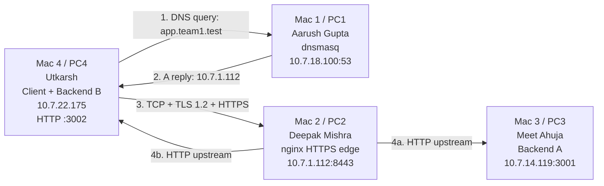

# Team Newts — Phase 1 Network Topology

## Machine, address, role and port

| Machine | Team member | Address | Role | Listening port |
|---|---|---|---|---|
| Mac 1 / PC1 | Aarush Gupta (2401020001) | `10.7.18.100` | Private DNS server (dnsmasq) | `53` UDP/TCP |
| Mac 2 / PC2 | Deepak Mishra (2401010142) | `10.7.1.112` | nginx HTTPS reverse proxy and load balancer | `8443` TCP |
| Mac 3 / PC3 | Meet Ahuja (2401010273) | `10.7.14.119` | Backend A | `3001` TCP/HTTP |
| Mac 4 / PC4 | Utkarsh (2401010484) | `10.7.22.175` | Backend B and test client | `3002` TCP/HTTP; ephemeral client ports |

All machines were on the same private Wi-Fi/LAN; no cloud host was used.

## Request flow

Mac 4 first sends a DNS A query for `app.team1.test` to Mac 1. Mac 1 answers with `10.7.1.112`, the address of Mac 2. Mac 4 then establishes a TCP connection to Mac 2 port `8443`, completes the TLS handshake, and sends the HTTPS request. nginx terminates TLS and forwards the request as HTTP to either Backend A on Mac 3 port `3001` or Backend B on Mac 4 port `3002`. The selected backend returns JSON plus `X-Backend`, `Cache-Control`, and `ETag` headers; nginx relays that response to the client over TLS.
